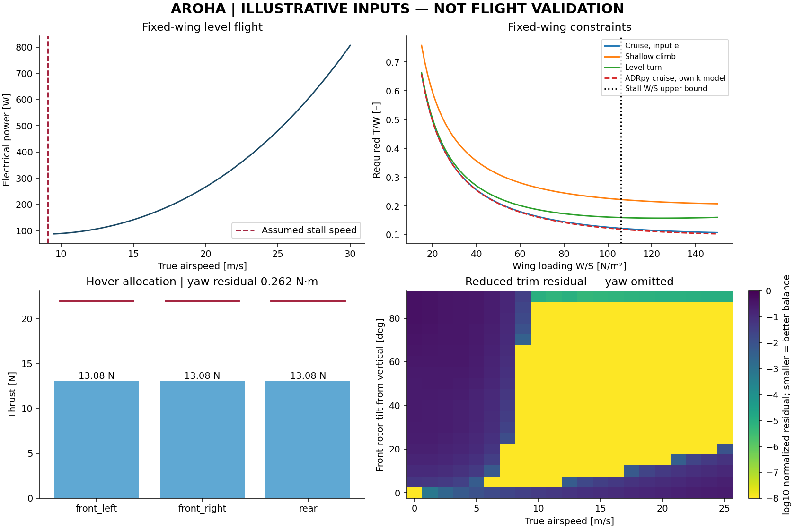

# AROHA aircraft engineering workbench

A Python/Jupyter environment for conceptual design of a **three-motor VTOL UAV**: hover, rotor transition screening and fixed-wing flight. The numerical baseline is pinned, inputs are recorded, and generated results carry assumptions and units.

**This is an operational analysis environment, not a finding that the actual aircraft will fly.** No actual CAD, mass breakdown, CG, airfoil, motor/propeller maps or control architecture were supplied. `configs/demo.json` contains synthetic demonstration values. The example assumes two front tilting rotors and one rear vertical rotor; change this to match the real architecture.

## What is working

| Tool | Integrated use | Verification performed |
|---|---|---|
| NumPy / SciPy / Matplotlib / pandas | SI calculations, constrained solves, parameter sweeps, plots and CSV tables | Analytical and limiting-case tests |
| ADRpy 0.2.6 | ISA atmosphere, fixed-wing cruise constraints; available propulsion/performance modules | Atmospheric reference and reconstructed cruise equation |
| SUAVE 2.5.2, pinned source commit | Vehicle/wing/three-rotor geometry skeleton, atmosphere; mission and propulsion framework available | Actual import, vehicle construction and atmosphere cross-check |
| OpenVSP 3.56.0 / bundled VSPAERO | Python geometry creation, angle-of-attack sweep and mesh-sensitivity study | Actual solver: 9 reference-wing cases across 3 meshes |
| JupyterLab | MATLAB-like interactive notebook, arrays, plots and editable inputs | Notebook cells checked in-process; live server/kernel blocked by this workspace's socket policy |

The SUAVE **aircraft-specific mission/network is not configured**. OpenVSP's verification wing **is not the real UAV**. Transition is a reduced static balance screen, not a six-degree-of-freedom simulation. See [model scope](docs/METHODS_AND_ASSUMPTIONS.md).

## Start in the prepared workspace

From the repository directory:

```bash
python scripts/run.py doctor
python scripts/run.py test -q
python scripts/run.py analyse
python scripts/run.py vsp
python scripts/run.py lab
```

Open `notebooks/01_conceptual_design.ipynb` and select **AROHA Engineering**. Use Shift+Enter to run cells. `run.py` selects the project's virtual environment and native-library paths; activation is not required.

Analysis outputs are written to `reports/runs/demo/`: PNG/PDF engineering plots, fixed-wing/constraint/mission/transition CSVs, a summary and JSON containing the complete input, SHA-256 input hash, dependency versions and timestamp. Committed [example outputs](reports/example/SUMMARY.md) show the workflow.



## Recreate on another computer

Use Python **3.11 or 3.12**, with an OpenVSP binary compiled for the same Python version and architecture. Do not install an unrelated PyPI package named `suave` or `openvsp`.

**Linux x86_64, Python 3.12:**

```bash
git clone https://github.com/Eeell10/Aroha.git
cd Aroha
python3.12 scripts/bootstrap.py --openvsp-linux
python scripts/run.py doctor
python scripts/run.py test -q
python scripts/run.py vsp
```

This extracts the official OpenVSP Ubuntu 24.04 binary and its missing libcminpack dependency into `vendor/`, without installing system packages. It was exercised on Debian 13 with Python 3.12.14. Linux must provide compatible glibc, libstdc++, libxml2 and libgomp. A different distribution may need a compatible build. See [installation details](docs/INSTALLATION.md).

**Windows 64-bit:** install Python 3.11, download and extract **OpenVSP 3.56.0 Windows Python 3.11** from the [official download page](https://openvsp.org/download.php), then run:

```powershell
py -3.11 scripts/bootstrap.py --openvsp-root "C:\Tools\OpenVSP-3.56.0-win64-Python3.11"
py -3.11 scripts/run.py doctor
py -3.11 scripts/run.py test -q
py -3.11 scripts/run.py vsp
py -3.11 scripts/run.py lab
```

Pass the extracted directory containing `python/`. Windows installation commands are supplied but were not executed in this Linux workspace. macOS uses a matching official Python 3.11 binary and `--openvsp-root`; it is also untested here.

To install ADRpy + SUAVE first, run `python scripts/bootstrap.py` without an OpenVSP option. `doctor` will correctly fail until the native backend is added. Existing `.venv` must match the Python interpreter used for bootstrap.

## Engineering workflow

1. Copy `configs/demo.json` to a new configuration and record the source/uncertainty of each input.
2. Establish all-up mass, CG and rotor locations; check hover allocation and yaw authority before motor selection.
3. Replace constant thrust and efficiency assumptions with measured propeller/motor/ESC/battery maps.
4. Run wing-loading, stall, power and energy studies. Iterate battery/structure mass; the starter does not close mass automatically.
5. Build the actual geometry and perform grid/wake refinement, airfoil/Reynolds checks, trim and stability analysis.
6. Configure SUAVE mission/network and an appropriate flight-dynamics/control simulation using the real architecture.

See [required aircraft inputs](docs/AIRCRAFT_INPUTS.md), [validation evidence](docs/VALIDATION.md) and [toolchain sources](docs/SOURCES.md).
